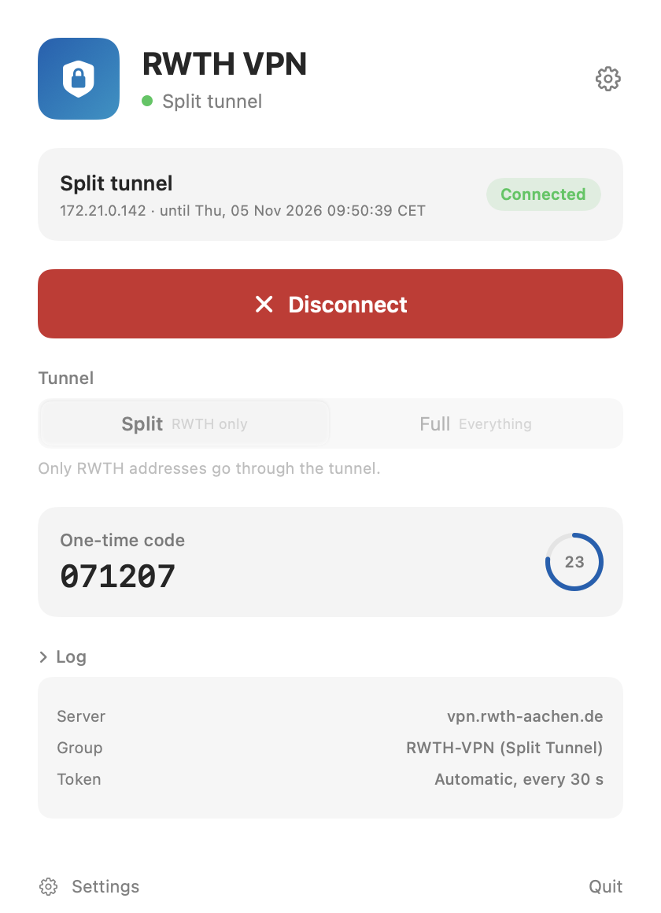
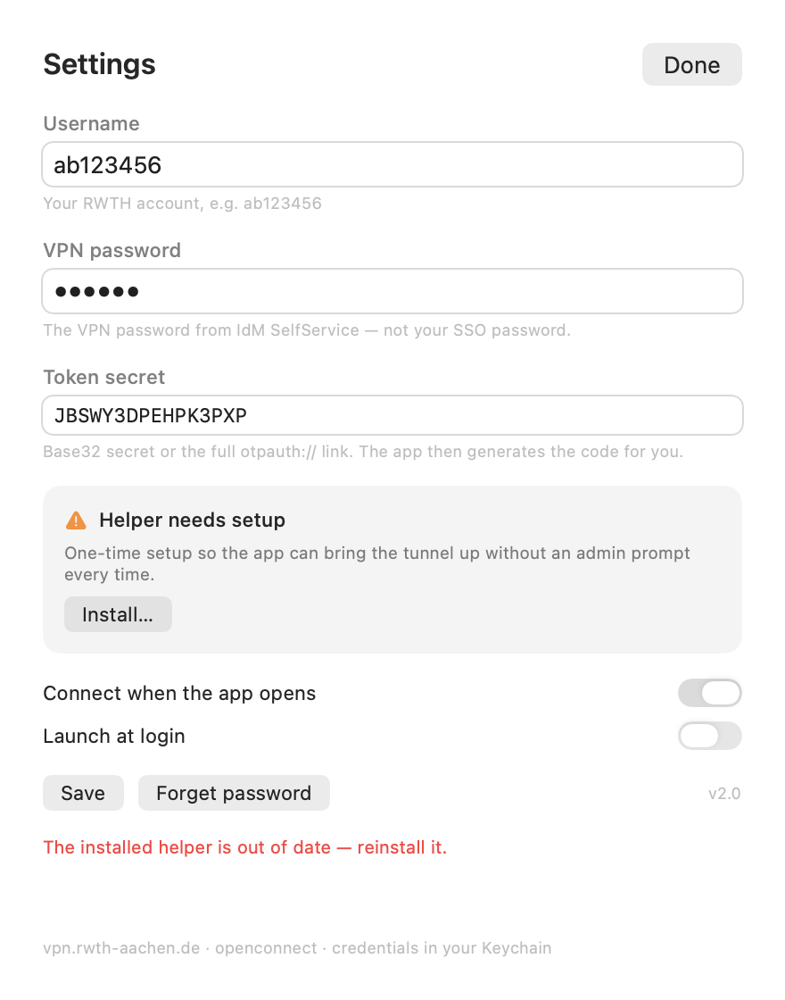

# RWTH VPN

A small, native macOS app for the RWTH Aachen VPN. It stores your credentials in
the Keychain, generates the TOTP code for you, and connects with one click — no
Cisco client, no Terminal, no Homebrew on the target machine.



> **Unofficial.** This is a student project. It is not affiliated with RWTH
> Aachen University or its IT Center, and the IT Center does not support it.
> The officially supported client is
> [Cisco Secure Client](https://help.itc.rwth-aachen.de/en/service/vbf6fx0gom76/article/35d4a399d2984c1f8d3e364e87c366dd/).
> Use at your own risk.

## Requirements

- **Apple Silicon** Mac (M1 or newer)
- **macOS 26** or newer
- A VPN account and a token, both set up in
  [IdM SelfService](https://idm.rwth-aachen.de/selfservice/Accounts?2)

Intel Macs are not supported. Use Cisco Secure Client there.

## Install

1. Download `RWTH VPN-1.0.0.dmg` from [Releases](../../releases/latest).
2. Open the DMG and drag **RWTH VPN** into **Applications**.
3. The app is not notarized (this project has no Apple Developer account), so
   macOS will block the first launch. Open it once, dismiss the dialog, then go
   to **System Settings → Privacy & Security**, scroll down and click
   **Open Anyway**, authenticate, and confirm.

   On macOS 26, use the **Open Anyway** flow described in `INSTALL.md`.

   Terminal alternative: `xattr -dr com.apple.quarantine "/Applications/RWTH VPN.app"`

Detailed steps with the exact dialogs: [INSTALL.md](INSTALL.md).

## First run

1. Open **RWTH VPN** and go to **Settings** (gear icon or ⌘,).
2. Enter your username (`ab123456`), your **VPN password** (the one from IdM
   SelfService, *not* your SSO password) and, optionally, your token secret
   (Base32 or the full `otpauth://` link).
3. Click **Install…** and confirm the admin prompt once. This installs a small
   root-owned helper and a bundled openconnect client so connecting needs no
   password prompt later.
4. **Connect** (⌘↩). The shield appears in the menu bar while the tunnel is up.

Without a token secret the app asks for the 6-digit code each time. With a
secret it generates the code locally and shows a countdown.



## Using it

- **Split tunnel** (default) routes only RWTH addresses through the VPN, so
  your local network and printer keep working.
- **Full tunnel** routes everything through RWTH.
- **Connect when the app opens** and **Launch at login** are in Settings.
- Closing the window keeps the app in the Dock; the menu bar shield is only
  shown while a session exists. Click it to bring the window back.
- Quitting the app leaves an active tunnel up; reopen the app to disconnect
  (it re-attaches to the running session).

## Uninstall

Settings → **Remove** (helper and sudoers rule), then quit and delete the app.
Manually:

```bash
sudo rm -rf /usr/local/libexec/rwth-vpn /usr/local/libexec/rwth-vpn-helper \
            /etc/sudoers.d/rwth-vpn-helper
```

Keychain items and preferences remain; remove them with **Forget password** and
`defaults delete dev.local.rwth-vpn`.

## Troubleshooting

| Symptom | Fix |
|---|---|
| "Apple could not verify…" on first launch | System Settings → Privacy & Security → **Open Anyway** (see [INSTALL.md](INSTALL.md)) |
| "Helper needs setup" | Settings → **Install…** |
| "Helper update available" | Settings → **Update…** — the bundled client changed |
| "a password is required" in the log | Reinstall the helper (sudoers rule is stale) |
| "The server rejected the password" | You entered your SSO password; use the VPN password from SelfService |
| "Login failed — wrong code or password" | The 6-digit code expired; try again |
| Repeated login failures | The gateway may temporarily block your IP after several failed attempts; wait a few minutes |
| Wrong IP / DNS after disconnect | Reconnect and disconnect once, or reboot; open an issue with the Log (Copy) |

More in [docs/FAQ.md](docs/FAQ.md).

## How it works

```
RWTH VPN.app ──(sudo -n)──▶ rwth-vpn-helper ──exec──▶ openconnect
     │                            │
     └─ Keychain (password, TOTP) └─ root-owned payload in /usr/local/libexec/rwth-vpn
```

The app never runs as root. It asks the helper to start openconnect, answers the
`Password:` and `Response:` prompts over stdin, and the helper's openconnect
configures the tunnel. The bundled client is a Homebrew openconnect with its
load paths rewritten and a CA bundle, so it works on Macs without Homebrew.

Details: [docs/ARCHITECTURE.md](docs/ARCHITECTURE.md), protocol notes:
[docs/PROTOCOL.md](docs/PROTOCOL.md).

## Build from source

```bash
brew install openconnect          # build-time only; bundled into the app
./build.sh                        # -> dist/RWTH VPN.app
"dist/RWTH VPN.app/Contents/MacOS/RWTHVPN" --selftest
```

`./build.sh --dmg` also produces a DMG. See [CONTRIBUTING.md](CONTRIBUTING.md)
for the test harness, debug flags and release process.

## Privacy and security

No telemetry. Credentials and the token secret live in your login Keychain and
are sent only to `vpn.rwth-aachen.de`. See [PRIVACY.md](PRIVACY.md) and
[SECURITY.md](SECURITY.md) (including how to report a vulnerability).

## Licence

MIT for the app ([LICENSE](LICENSE)). The bundled openconnect and its
dependencies keep their own licences; see
[THIRD-PARTY-NOTICES.md](THIRD-PARTY-NOTICES.md).
